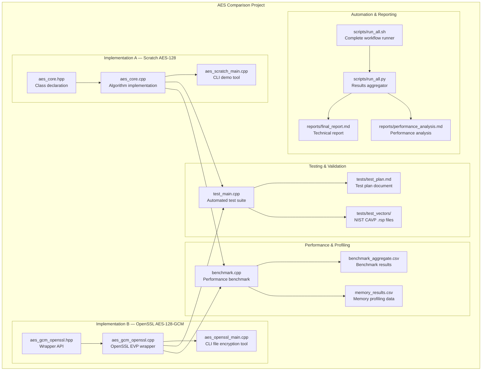
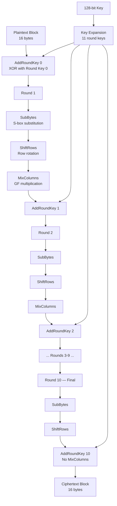
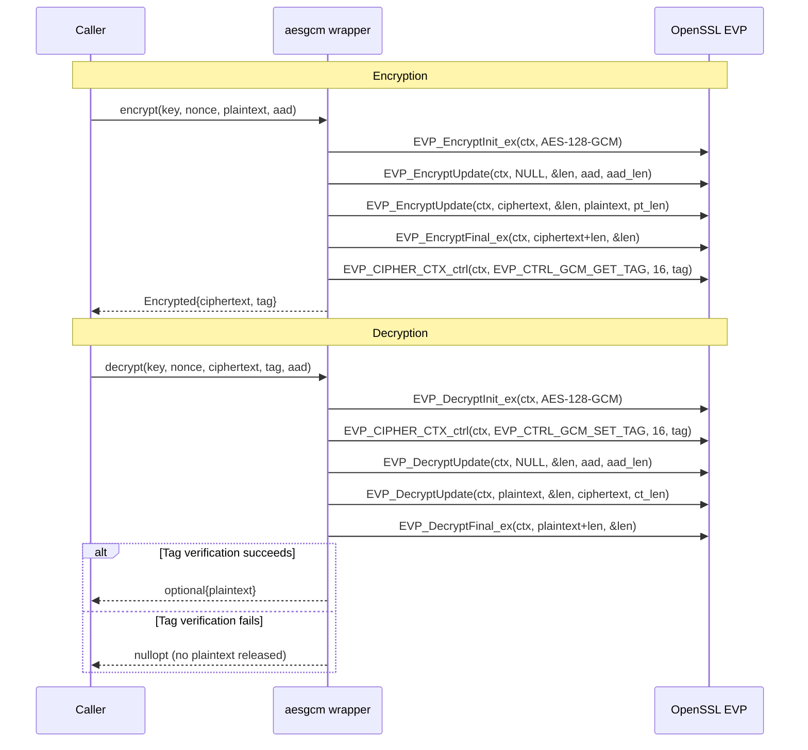
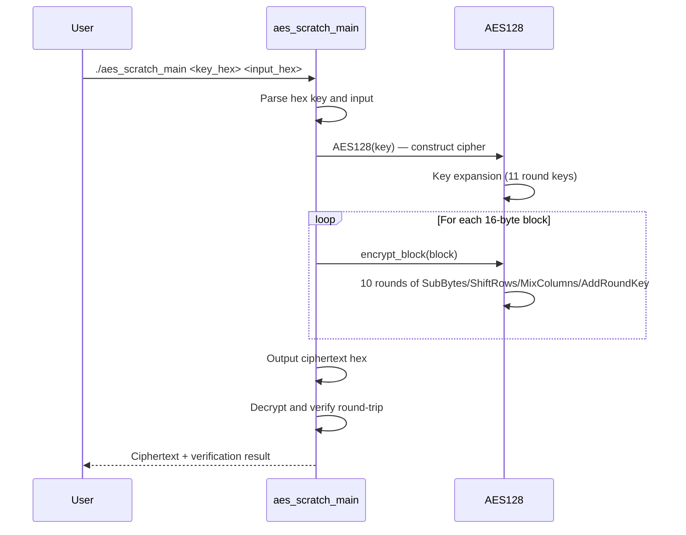
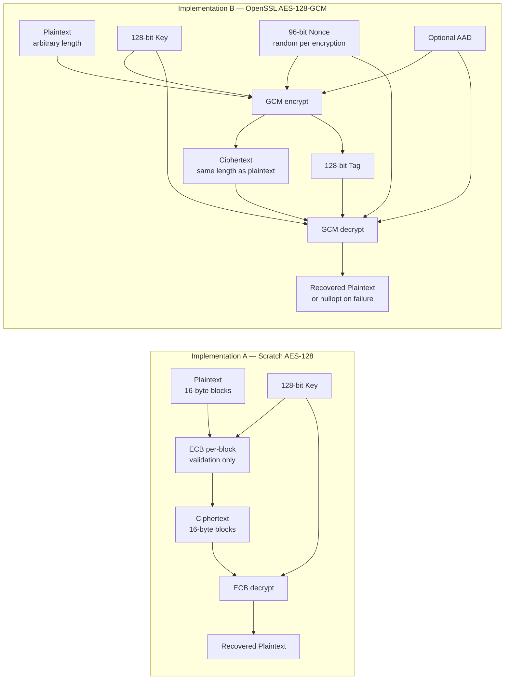
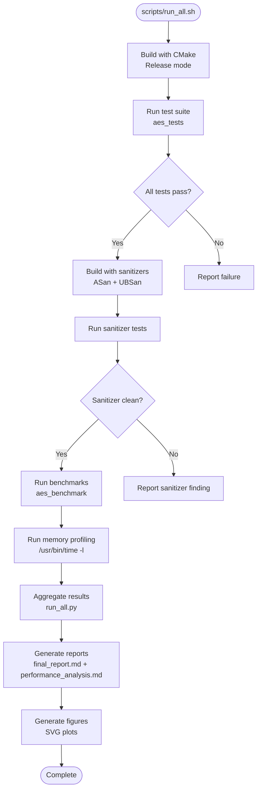

# System Architecture

## Overview

The AES Comparison Project is a C++ software security project that implements and compares two approaches to AES-128 encryption:

- **Implementation A** — A from-scratch AES-128 block cipher following FIPS 197, designed for education and validation.
- **Implementation B** — An OpenSSL-based AES-128-GCM authenticated encryption wrapper, designed for production use.

The project includes a comprehensive test suite, performance benchmarks, memory profiling, and automated CI-style scripts.

---

## Overall System Components



---

## AES Encryption Round Flow (Implementation A)

AES-128 performs 10 rounds of transformation on a 128-bit state. Each round (except the last) applies four transformations in sequence.



### Transformation Details

| Transformation | Operation | Purpose |
|---|---|---|
| **SubBytes** | Non-linear byte substitution via S-box | Confusion |
| **ShiftRows** | Cyclic left shift of each row by row index | Diffusion |
| **MixColumns** | GF(2^8) matrix multiplication per column | Diffusion |
| **AddRoundKey** | XOR state with round-specific subkey | Key mixing |

---

## AES Key Expansion Process

The 128-bit key is expanded into 11 round keys (176 bytes total) using the FIPS 197 key schedule.

```mermaid
flowchart LR
    KEY[128-bit Key<br/>16 bytes] --> SPLIT[Split into 4 words<br/>w0, w1, w2, w3]

    SPLIT --> RK0[Round Key 0<br/>w0 || w1 || w2 || w3]

    W3[w3] --> ROT[RotWord<br/>Cyclic left rotate]
    ROT --> SUB[SubWord<br/>S-box each byte]
    SUB --> RCON[XOR with Rcon<br/>Round constant]
    RCON --> W4[w4 = w0 XOR result]

    W4 --> RK1[Round Key 1<br/>w4 || w5 || w6 || w7]

    W4 --> W5[w5 = w1 XOR w4]
    W5 --> W6[w6 = w2 XOR w5]
    W6 --> W7[w7 = w3 XOR w6]

    W7 --> W8[w8 = w4 XOR SubWord-RotWord-w7 XOR Rcon]
    W8 --> RKN[Round Keys 2-10<br/>Same pattern repeats]

    RK0 --> SCHEDULE[RoundKeySchedule<br/>176 bytes]
    RK1 --> SCHEDULE
    RKN --> SCHEDULE
```

### Key Expansion Formula

For word index `i >= 4`:

- If `i mod 4 != 0`: `w[i] = w[i-4] XOR w[i-1]`
- If `i mod 4 = 0`: `w[i] = w[i-4] XOR SubWord(RotWord(w[i-1])) XOR Rcon[i/4]`

---

## OpenSSL GCM Encrypt/Decrypt Flow (Implementation B)



---

## CLI Execution Sequence

### Scratch AES CLI (`aes_scratch_main`)



### OpenSSL GCM CLI (`aes_openssl_main`)

```mermaid
sequenceDiagram
    participant U as User
    participant CLI as aes_openssl_main
    participant W as aesgcm wrapper
    participant O as OpenSSL

    U->>CLI: ./aes_openssl_main <encrypt|decrypt> <key_file> <input> <output>
    alt Encrypt
        CLI->>W: encrypt_with_random_nonce(key, plaintext)
        W->>O: RAND_bytes(nonce, 12)
        W->>O: EVP AES-128-GCM encrypt
        W-->>CLI: blob = nonce || ciphertext || tag
        CLI->>CLI: Write blob to output file
    else Decrypt
        CLI->>CLI: Read blob from input file
        CLI->>CLI: Parse nonce (12) || ciphertext (n) || tag (16)
        CLI->>W: decrypt_blob(key, blob)
        W->>O: EVP AES-128-GCM decrypt + tag verify
        alt Tag valid
            W-->>CLI: plaintext
            CLI->>CLI: Write plaintext to output file
        else Tag invalid
            W-->>CLI: nullopt
            CLI->>CLI: Error: authentication failed
        end
    end
```



---

## Data Flow



### Data Formats

| Artifact | Implementation A | Implementation B |
|---|---|---|
| Key | 16 bytes (raw) | 16 bytes (raw) |
| Nonce/IV | N/A | 12 bytes (random) |
| Plaintext | Multiple of 16 bytes | Arbitrary length |
| Ciphertext | Same as plaintext | Same as plaintext |
| Authentication | None | 16-byte tag |
| AAD | N/A | Optional, arbitrary length |
| File format | N/A | `nonce(12) \|\| tag(16) \|\| ciphertext(n)` |

---

## Testing/CI Pipeline



### Test Suite Structure

The test suite (`test_main.cpp`) is organized into six categories:

| Category | Description | Test Count |
|---|---|---|
| A | Known-answer tests (FIPS 197 + NIST CAVP) | 282 cases |
| B | Round-trip tests (scratch ECB + OpenSSL GCM) | 17 cases |
| C | Boundary tests (input sizes 0 to 10 MiB) | 14 cases |
| D | Negative/tampering tests | 36 cases |
| E | Cross-validation (scratch vs OpenSSL) | 1000 blocks |
| F | Determinism/regression checks | 5 checks |
| **Total** | | **1431 checks** |

---

## Benchmark Measurement Pipeline

```mermaid
flowchart TD
    subgraph "Benchmark Execution"
        B1[aes_benchmark binary] --> B2[Parse CLI args<br/>--impl --op --size --reps --warmup --csv]
        B2 --> B3[Generate random input<br/>seed 0xBEEF]
        B3 --> B4[Warmup iterations<br/>default 3]
        B4 --> B5[Timed repetitions<br/>std::chrono::steady_clock]
        B5 --> B6[Compute checksum<br/>prevent dead-code elimination]
        B6 --> B7[Write CSV row<br/>per repetition]
    end

    subgraph "Aggregation"
        A1[benchmark_results.csv<br/>per-rep data] --> A2[run_all.py<br/>aggregate statistics]
        A2 --> A3[benchmark_aggregate.csv<br/>mean, median, stdev, min, max]
    end

    subgraph "Memory Profiling"
        M1[/usr/bin/time -l<br/>peak RSS] --> M2[memory_results.csv<br/>per configuration]
    end

    subgraph "Reporting"
        R1[benchmark_aggregate.csv] --> R2[performance_analysis.md]
        M2 --> R2
        R2 --> R3[SVG figures<br/>throughput, latency, scaling]
    end
```

### Benchmark Configuration

| Parameter | Value |
|---|---|
| Input sizes | 16 B, 1 KiB, 100 KiB, 1 MiB, 10 MiB |
| Repetitions | 10 (small), 3 (1 MiB scratch), 2 (10 MiB scratch) |
| Warmup | 3 iterations |
| Timing | `std::chrono::steady_clock` (monotonic, ns resolution) |
| Optimization | `-O3` (Release) |
| Checksum | FNV-1a hash of output (prevent dead-code elimination) |
| Memory tool | `/usr/bin/time -l` (peak RSS on macOS) |

---

## Project File Structure

```
AES/
├── CMakeLists.txt              # Build configuration
├── README.md                   # Project overview
├── src/
│   ├── aes_core.hpp            # Implementation A header
│   ├── aes_core.cpp            # Implementation A source
│   ├── aes_gcm_openssl.hpp     # Implementation B header
│   ├── aes_gcm_openssl.cpp     # Implementation B source
│   ├── aes_scratch_main.cpp    # CLI demo (scratch)
│   ├── aes_openssl_main.cpp    # CLI file encryption (OpenSSL)
│   ├── test_main.cpp           # Automated test suite
│   └── benchmark.cpp           # Performance benchmark
├── tests/
│   ├── test_plan.md            # Test plan document
│   └── test_vectors/           # NIST CAVP .rsp files
│       ├── ECBGFSbox128.rsp
│       ├── ECBVarTxt128.rsp
│       ├── ECBVarKey128.rsp
│       ├── ECBMMT128.rsp
│       ├── gcmEncryptExtIV128_subset.rsp
│       └── gcmDecrypt128_subset.rsp
├── scripts/
│   ├── run_all.sh              # Complete workflow runner
│   ├── run_all.py              # Results aggregator
│   └── extract_gcm_subset.py   # GCM test vector subsetter
├── results/
│   ├── test_results.txt        # Test suite output
│   ├── sanitizer_test_results.txt
│   ├── benchmark_results.csv   # Per-repetition data
│   ├── benchmark_aggregate.csv # Summary statistics
│   ├── memory_results.csv      # Memory profiling data
│   └── environment.txt         # System information
├── reports/
│   ├── final_report.md         # Technical report
│   └── performance_analysis.md # Performance analysis
├── docs/                       # Documentation (this directory)
└── figures/                    # Generated SVG plots
```
