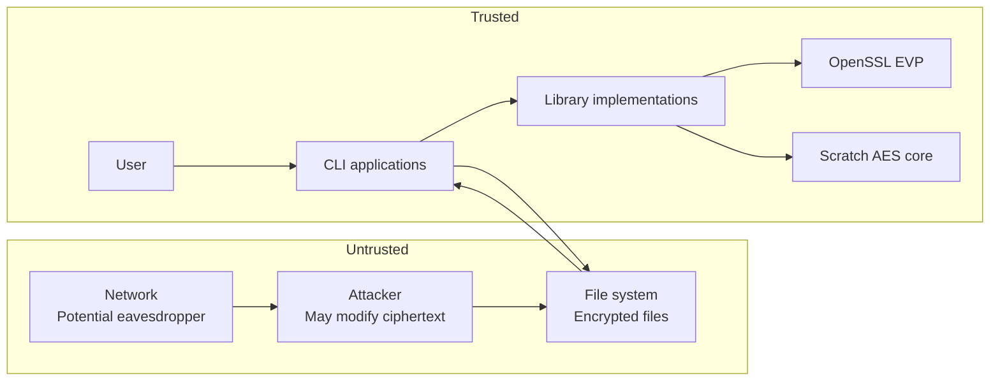

# Security Model

## Overview

This document describes the security model for the AES Comparison Project, including assets, trust boundaries, attacker capabilities, threats, mitigations, and residual risks.

---

## Assets

| Asset | Description | Value |
|---|---|---|
| **Key material** | 128-bit AES keys used for encryption | High — compromise reveals all encrypted data |
| **Plaintext** | Data being encrypted/decrypted | High — the data the encryption protects |
| **Ciphertext** | Encrypted data | Medium — useless without key, but reveals patterns (ECB) |
| **Authentication tag** | 128-bit GCM tag | High — compromise allows undetected tampering |
| **Nonce/IV** | 96-bit random value | Medium — reuse with same key breaks GCM security |
| **Implementation code** | Source code of both implementations | Medium — vulnerabilities affect all users |
| **Test vectors** | NIST CAVP test data | Low — public information |

---

## Trust Boundaries

### Boundary Descriptions

| Boundary | Description |
|---|---|
| **User / CLI** | The user invokes the CLI with key material and input. The CLI trusts user input but validates format. |
| **CLI / Library** | The CLI passes validated key material to the library. The library performs encryption/decryption. |
| **Library / File System** | Encrypted output is written to files. The file system is untrusted — files may be read or modified by an attacker. |
| **File System / Attacker** | An attacker can read, modify, truncate, or replay encrypted files. |
| **Library / OpenSSL** | Implementation B trusts OpenSSL's EVP interface. Implementation A is self-contained. |

---

## Attacker Capabilities

### Capabilities

| Capability | Description |
|---|---|
| **Eavesdropping** | Read encrypted files or ciphertext in transit |
| **Modification** | Flip bits in ciphertext, tag, or nonce |
| **Truncation** | Remove bytes from ciphertext or tag |
| **Replay** | Re-present a previously valid encrypted file |
| **Known plaintext** | Know or guess some plaintext content |
| **Key recovery attempts** | Attempt to recover the key through analysis |

### Non-Capabilities

| Capability | Description |
|---|---|
| **Key compromise** | The attacker does NOT know the secret key |
| **Side-channel access** | No timing, power, or EM side-channel access (outside scope) |
| **Quantum computing** | Not considered in this threat model |

---

## Threats and Mitigations

### TH-01: Ciphertext Tampering (Implementation A)

| Aspect | Details |
|---|---|
| **Threat** | An attacker modifies ECB ciphertext blocks |
| **Impact** | Undetected — the scratch implementation has no authentication |
| **Mitigation** | **None** — this is a documented limitation. The scratch implementation must NOT be used for real data. |
| **Residual risk** | **High** — ECB mode leaks plaintext patterns and provides no integrity protection |

### TH-02: Ciphertext Tampering (Implementation B)

| Aspect | Details |
|---|---|
| **Threat** | An attacker modifies GCM ciphertext |
| **Impact** | **Detected** — GCM tag verification fails, `nullopt` returned, no plaintext released |
| **Mitigation** | 128-bit GMAC authentication tag verified before any plaintext is returned |
| **Residual risk** | **Low** — computationally infeasible to forge a valid tag without the key |

### TH-03: Nonce Reuse (Implementation B)

| Aspect | Details |
|---|---|
| **Threat** | An attacker causes nonce reuse with the same key |
| **Impact** | GCM security breaks — confidentiality and integrity compromised |
| **Mitigation** | Fresh 96-bit random nonce generated via `RAND_bytes` for every encryption |
| **Residual risk** | **Low** — with 96-bit nonces, collision probability is negligible for practical usage (birthday bound ~2^48 encryptions) |

### TH-04: Tag Modification

| Aspect | Details |
|---|---|
| **Threat** | An attacker modifies the 128-bit authentication tag |
| **Impact** | **Detected** — tag verification fails |
| **Mitigation** | Tag is verified by `EVP_DecryptFinal_ex` before plaintext release |
| **Residual risk** | **None** — any modification causes verification failure |

### TH-05: Key Exposure via Error Messages

| Aspect | Details |
|---|---|
| **Threat** | OpenSSL error messages leak key material or plaintext |
| **Impact** | Key or plaintext disclosure |
| **Mitigation** | Generic `OperationError` thrown instead of propagating OpenSSL error strings |
| **Residual risk** | **Low** — error messages are generic and contain no key material |

### TH-06: Side-Channel Attacks (Timing)

| Aspect | Details |
|---|---|
| **Threat** | Timing analysis of the scratch implementation's byte-by-byte GF multiplication |
| **Impact** | Key recovery via timing side-channel |
| **Mitigation** | **None** — documented limitation. The scratch implementation is not constant-time. |
| **Residual risk** | **High** for the scratch implementation (educational only); **Low** for OpenSSL (uses hardware AES instructions which are constant-time) |

### TH-07: Memory Exposure

| Aspect | Details |
|---|---|
| **Threat** | Sensitive data (keys, plaintext) remains in memory after use |
| **Impact** | Keys or plaintext recoverable from memory dumps |
| **Mitigation** | RAII management of OpenSSL contexts; keys stored in stack-allocated arrays |
| **Residual risk** | **Low** — no explicit memory wiping; keys may persist in freed memory |

### TH-08: Weak Key Generation

| Aspect | Details |
|---|---|
| **Threat** | Predictable or weak keys |
| **Impact** | Key recovery by brute force or prediction |
| **Mitigation** | `RAND_bytes` for key generation (CLI `keygen` subcommand) |
| **Residual risk** | **None** — uses OpenSSL's cryptographically secure RNG |

---

## Security Properties by Implementation

| Property | Implementation A (Scratch) | Implementation B (OpenSSL GCM) |
|---|---|---|
| Confidentiality | Yes (AES-128) | Yes (AES-128) |
| Integrity/Authentication | **No** | Yes (128-bit GMAC tag) |
| Tamper detection | **No** | Yes — tag verified before release |
| Nonce uniqueness | N/A | Fresh random 96-bit nonce |
| Constant-time | **No** | Yes (hardware AES) |
| Padding oracle | No (no padding) | No (GCM is stream mode) |
| Error message safety | Safe | Generic errors only |
| RAII resource management | N/A | Yes (unique_ptr + custom deleter) |
| Key generation | N/A | RAND_bytes (CSPRNG) |

---

## Security Recommendations

1. **Use Implementation B (OpenSSL GCM) for all real encryption** — never use the scratch implementation for production data.
2. **Never reuse a nonce with the same key** — the CLI generates fresh nonces automatically.
3. **Protect key files** — the `keygen` subcommand sets file permissions to `0600`.
4. **Verify the authentication tag** — the GCM wrapper verifies before releasing plaintext.
5. **Use constant-time implementations** — OpenSSL uses hardware AES instructions; the scratch implementation does not.
6. **Validate all inputs** — both CLIs validate key length, nonce size, and file format.

---

## Residual Risks Summary

| Risk | Implementation A | Implementation B |
|---|---|---|
| Ciphertext tampering undetected | **High** | None |
| Nonce reuse | N/A | **Low** |
| Timing side-channel | **High** | **Low** |
| Memory exposure | **Medium** | **Low** |
| Key compromise | **Medium** | **Low** |
| Side-channel (power/EM) | **Medium** | **Low** |
