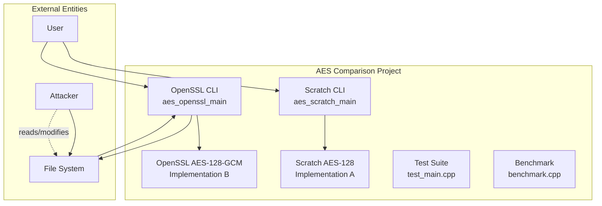
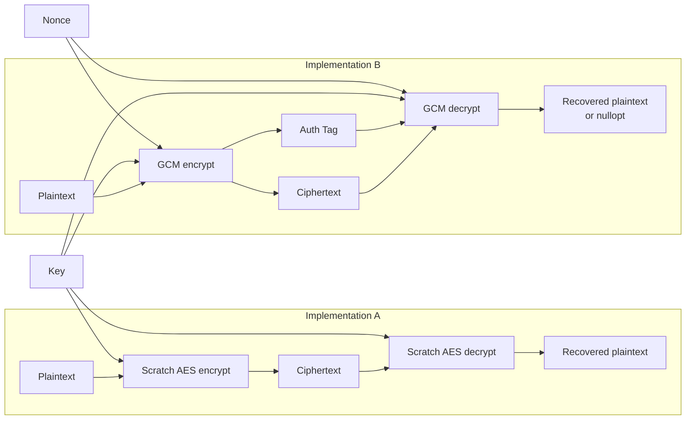
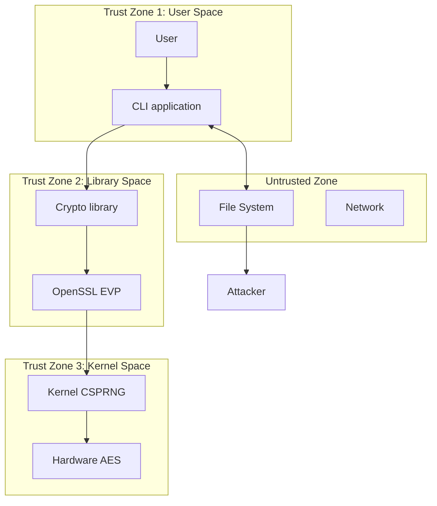

# Threat Model

## Overview

This document provides a formal threat model for the AES Comparison Project using the STRIDE methodology. It identifies threats to both implementations and the overall system, assesses their risk, and documents mitigations.

---

## STRIDE Methodology

STRIDE categorizes threats into six types:

| Letter | Threat Type | Description |
|---|---|---|
| **S** | Spoofing | Impersonating a legitimate entity |
| **T** | Tampering | Modifying data or code |
| **R** | Repudiation | Denying an action occurred |
| **I** | Information Disclosure | Exposing sensitive data |
| **D** | Denial of Service | Making a system unavailable |
| **E** | Elevation of Privilege | Gaining unauthorized access |

---

## System Context

---

## Data Flow Diagram

---

## Threat Analysis

### SPOOFING (S)

| ID | Threat | Component | Risk | Mitigation | Residual Risk |
|---|---|---|---|---|---|
| S-01 | Attacker generates a valid-looking key file | CLI_B keygen | Low | `RAND_bytes` uses CSPRNG; keys are cryptographically random | None |
| S-02 | Attacker presents a forged encrypted file | File system | Medium | GCM tag verification rejects forged files | None |

### TAMPERING (T)

| ID | Threat | Component | Risk | Mitigation | Residual Risk |
|---|---|---|---|---|---|
| T-01 | Attacker modifies ECB ciphertext blocks | Implementation A | **High** | **None** — no authentication in scratch implementation | **High** — documented limitation |
| T-02 | Attacker modifies GCM ciphertext | Implementation B | Medium | 128-bit GMAC tag detects any modification | None |
| T-03 | Attacker modifies GCM tag | Implementation B | Medium | Tag verification fails on any modification | None |
| T-04 | Attacker modifies nonce | Implementation B | Medium | Tag verification fails on nonce modification | None |
| T-05 | Attacker modifies AAD | Implementation B | Medium | Tag verification fails on AAD modification | None |
| T-06 | Attacker truncates ciphertext | Implementation B | Medium | GCM rejects truncated input | None |
| T-07 | Attacker modifies source code | Any | Medium | Code review, compiler warnings (`-Wall -Wextra -Wpedantic`) | Low |

### REPUDIATION (R)

| ID | Threat | Component | Risk | Mitigation | Residual Risk |
|---|---|---|---|---|---|
| R-01 | User denies encrypting a file | CLI_B | Low | Not applicable — local CLI tool, no audit logging | N/A |
| R-02 | User denies decrypting a file | CLI_B | Low | Not applicable — local CLI tool | N/A |

### INFORMATION DISCLOSURE (I)

| ID | Threat | Component | Risk | Mitigation | Residual Risk |
|---|---|---|---|---|---|
| I-01 | OpenSSL error messages leak key/plaintext | Implementation B | Medium | Generic `OperationError` thrown; OpenSSL error strings not propagated | None |
| I-02 | Key material in memory after use | Both | Medium | RAII for OpenSSL contexts; stack-allocated key arrays | **Medium** — no explicit memory wiping |
| I-03 | ECB leaks plaintext patterns | Implementation A | **High** | **None** — ECB inherently leaks patterns; documented limitation | **High** |
| I-04 | Timing side-channel leaks key | Implementation A | **High** | **None** — byte-by-byte GF multiplication is not constant-time | **High** |
| I-05 | Timing side-channel leaks key | Implementation B | Low | OpenSSL uses hardware AES instructions (constant-time) | Low |
| I-06 | Key file permissions too permissive | CLI_B keygen | Low | `chmod 0600` (owner read/write only) | None |

### DENIAL OF SERVICE (D)

| ID | Threat | Component | Risk | Mitigation | Residual Risk |
|---|---|---|---|---|---|
| D-01 | Extremely large input causes memory exhaustion | Both | Low | Input size bounded by system memory; no unbounded allocation | Low |
| D-02 | Malformed input causes crash | Both | Medium | Input validation, null pointer checks, size validation | Low |
| D-03 | Resource exhaustion via EVP context leak | Implementation B | Low | RAII (`unique_ptr` + custom deleter) ensures cleanup | None |

### ELEVATION OF PRIVILEGE (E)

| ID | Threat | Component | Risk | Mitigation | Residual Risk |
|---|---|---|---|---|---|
| E-01 | Buffer overflow in scratch implementation | Implementation A | Medium | ASan+UBSan clean; `std::array` bounds checking; `-Wall -Wextra -Wpedantic` | Low |
| E-02 | Use-after-free in OpenSSL context | Implementation B | Low | RAII management prevents premature freeing | None |

---

## Risk Assessment Matrix

| ID | Threat | Likelihood | Impact | Risk Level |
|---|---|---|---|---|
| T-01 | ECB ciphertext tampering undetected | High | High | **Critical** |
| T-02 | GCM ciphertext modification | High | Low | Low |
| T-03 | GCM tag modification | High | Low | Low |
| I-03 | ECB leaks plaintext patterns | High | High | **High** |
| I-04 | Timing side-channel (scratch) | Medium | High | **High** |
| I-01 | Error message leakage | Low | Medium | Low |
| I-02 | Key material in memory | Medium | Medium | **Medium** |
| D-01 | Memory exhaustion | Low | Medium | Low |
| E-01 | Buffer overflow | Low | High | Low |

---

## Key Findings

### Critical Risks

1. **T-01: ECB ciphertext tampering** — The scratch implementation (Implementation A) provides no authentication. An attacker can modify ECB ciphertext undetected. **Mitigation**: Documented limitation. Use Implementation B for all real encryption.

### High Risks

1. **I-03: ECB plaintext pattern leakage** — ECB mode encrypts identical plaintext blocks to identical ciphertext blocks, revealing patterns. **Mitigation**: Documented limitation. Use GCM mode (Implementation B) for real encryption.

2. **I-04: Timing side-channel in scratch implementation** — Byte-by-byte GF(2^8) multiplication is not constant-time. **Mitigation**: Documented limitation. The scratch implementation is for educational use only.

### Medium Risks

1. **I-02: Key material in memory** — No explicit memory wiping of key material. **Mitigation**: RAII manages OpenSSL contexts; keys in stack arrays. **Residual**: Keys may persist in freed memory.

---

## Trust Boundary Analysis

---

## Assumptions

1. The secret key is kept confidential by the user.
2. The attacker does not have physical access to the machine.
3. The attacker cannot perform side-channel analysis (timing, power, EM) at the hardware level — except for the documented timing limitation of the scratch implementation.
4. The OpenSSL library is not compromised.
5. The operating system provides basic process isolation.

---

## Out of Scope

- Side-channel attacks requiring physical access (power analysis, EM analysis)
- Quantum computing attacks
- Supply chain attacks on OpenSSL or the compiler
- Social engineering attacks against the user
- Key management infrastructure (KMI)
